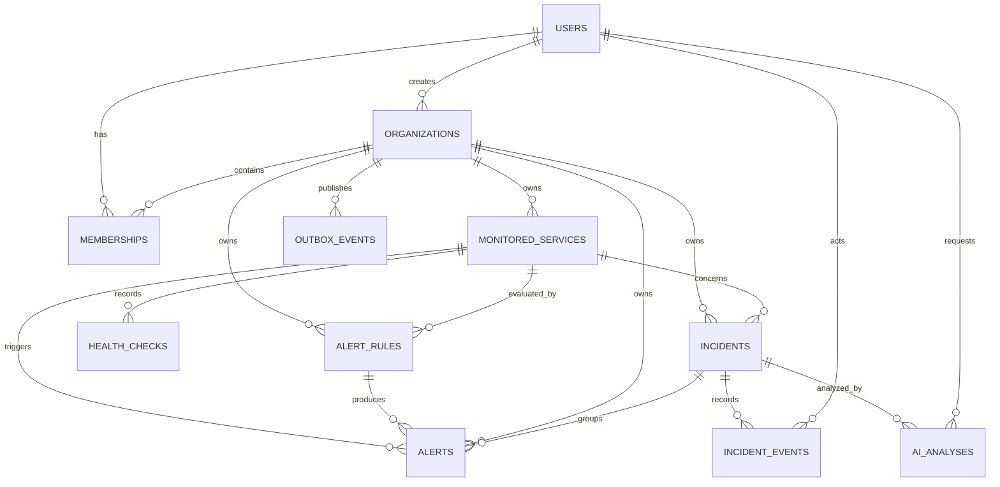
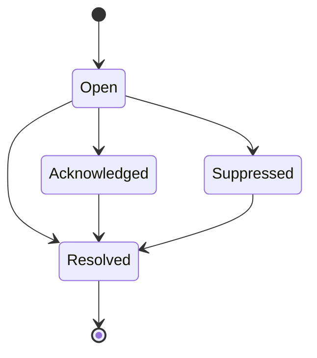
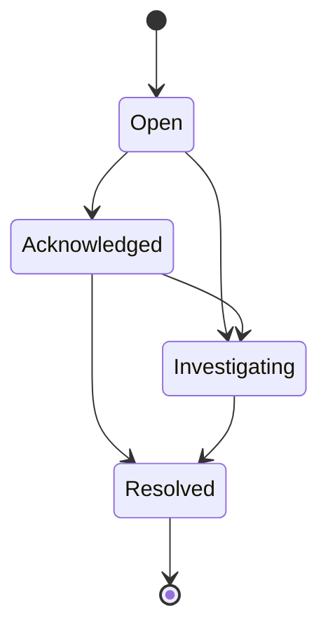

# Distridbug — Database Design

**Status:** Initial logical design (v0.1)  
**Database:** PostgreSQL  
**Related documents:** `README.md`, `docs/PRD.md`, `docs/ARCHITECTURE.md`

> This is a proposed MVP schema, not a claim that the database has already been implemented. Adjust it through documented decisions as implementation and measured usage reveal new requirements.

## 1. Goals and principles

The schema must support organization-level tenancy, user membership, monitored services, durable health-check history, alert rules, alerts, incidents, an incident timeline, optional AI analysis, and reliable asynchronous event publication.

Design principles:

- PostgreSQL is the source of truth. Redis and RabbitMQ support coordination and asynchronous processing; they do not replace durable business records.
- Keep the transactional core relational. Use columns, foreign keys, unique constraints, and check constraints for important business data.
- Every tenant-owned record must be scoped to an `organization_id`, directly or through a rigorously enforced parent relationship.
- Use UUID primary keys and `timestamptz` timestamps stored in UTC.
- Keep historical evidence append-only where practical. A new health check or incident event creates a new row.
- Use JSONB only for variable evidence and metadata, not for fields that need ordinary filtering, joining, or constraints.
- Avoid premature partitioning and micro-optimizations. Measure query plans and data growth first.

## 2. Entity relationship overview



For the MVP, each alert belongs to at most one incident; an incident may group multiple alerts. An alert may exist without an incident while the incident-creation policy is evaluated.

## 3. Tables

All IDs below are UUIDs unless specified otherwise. All timestamps are `timestamptz`. `PK` = primary key; `FK` = foreign key.

### 3.1 `users`

Platform identities.

| Column | Type | Rules / purpose |
|---|---|---|
| `id` | UUID | PK |
| `email` | VARCHAR(320) | Required; normalize to lowercase |
| `password_hash` | TEXT | Required for password auth; never plaintext |
| `is_active` | BOOLEAN | Required; default `true` |
| `created_at` | TIMESTAMPTZ | Required |
| `updated_at` | TIMESTAMPTZ | Required |

Use a unique index on `lower(email)` to enforce case-insensitive uniqueness. If authentication later moves to an identity provider, revise the credential fields rather than storing provider secrets.

### 3.2 `organizations`

A tenant boundary for services, rules, alerts, and incidents.

| Column | Type | Rules / purpose |
|---|---|---|
| `id` | UUID | PK |
| `name` | VARCHAR(160) | Required |
| `slug` | VARCHAR(100) | Required; unique |
| `created_by_user_id` | UUID | FK → `users.id`, required |
| `created_at` | TIMESTAMPTZ | Required |

### 3.3 `memberships`

Connects users to organizations.

| Column | Type | Rules / purpose |
|---|---|---|
| `id` | UUID | PK |
| `organization_id` | UUID | FK → `organizations.id`, required |
| `user_id` | UUID | FK → `users.id`, required |
| `role` | VARCHAR(20) | `owner` or `member` |
| `created_at` | TIMESTAMPTZ | Required |

Add unique `(organization_id, user_id)` and an index on `(user_id, organization_id)`. Enforce at least one active owner per organization in transactional application logic; a simple row-level check cannot enforce this cross-row invariant.

### 3.4 `monitored_services`

Endpoint configuration used by the scheduler.

| Column | Type | Rules / purpose |
|---|---|---|
| `id` | UUID | PK |
| `organization_id` | UUID | FK → `organizations.id`, required |
| `name` | VARCHAR(160) | Required |
| `description` | TEXT | Optional |
| `target_url` | TEXT | Required; SSRF validation required |
| `check_interval_seconds` | INTEGER | Required; positive and bounded |
| `timeout_seconds` | INTEGER | Required; positive and less than interval |
| `expected_status_code` | SMALLINT | Optional; default policy may accept 200–299 |
| `is_enabled` | BOOLEAN | Required; default `true` |
| `next_check_at` | TIMESTAMPTZ | Required; next due time |
| `created_by_user_id` | UUID | FK → `users.id`, required |
| `created_at` | TIMESTAMPTZ | Required |
| `updated_at` | TIMESTAMPTZ | Required |

Consider unique `(organization_id, name)`. Add a scheduler index on `(is_enabled, next_check_at)`, preferably partial for enabled rows. Validate URLs at registration and at connection time: block loopback, private, link-local, and cloud metadata destinations; validate DNS resolution and redirects; use network egress restrictions. URL validation is a security boundary, not just input formatting.

### 3.5 `health_checks`

An immutable record of one monitoring attempt.

| Column | Type | Rules / purpose |
|---|---|---|
| `id` | UUID | PK |
| `organization_id` | UUID | Required; tenant scope |
| `service_id` | UUID | FK → `monitored_services.id`, required |
| `job_id` | UUID | Required; scheduled execution identity |
| `status` | VARCHAR(20) | `healthy`, `unhealthy`, `timeout`, or `error` |
| `http_status_code` | SMALLINT | Optional |
| `response_time_ms` | INTEGER | Optional; non-negative |
| `checked_at` | TIMESTAMPTZ | Required; completion time |
| `error_code` | VARCHAR(80) | Optional; machine-readable category |
| `error_message` | TEXT | Optional; sanitized and bounded |
| `created_at` | TIMESTAMPTZ | Required |

Make `job_id` unique (or use a suitable composite idempotency key) so retrying a job cannot persist a duplicate result. Check that `response_time_ms IS NULL OR response_time_ms >= 0`. Index `(service_id, checked_at DESC)` and `(organization_id, checked_at DESC)`. Do not store authorization headers, cookies, credentials, or response bodies by default.

### 3.6 `alert_rules`

Conditions that turn health-check evidence into alerts.

| Column | Type | Rules / purpose |
|---|---|---|
| `id` | UUID | PK |
| `organization_id` | UUID | FK → `organizations.id`, required |
| `service_id` | UUID | FK → `monitored_services.id`, nullable for org-wide rules |
| `name` | VARCHAR(160) | Required |
| `rule_type` | VARCHAR(40) | e.g. `consecutive_failures`, `response_time`, `failure_ratio` |
| `threshold` | NUMERIC(12,3) | Required; interpretation depends on rule type |
| `window_seconds` | INTEGER | Optional; required for window-based rules |
| `severity` | VARCHAR(20) | `low`, `medium`, `high`, or `critical` |
| `is_enabled` | BOOLEAN | Required; default `true` |
| `created_at` | TIMESTAMPTZ | Required |
| `updated_at` | TIMESTAMPTZ | Required |

Keep rule types explicit and validated. Do not create an unrestricted expression language for the MVP. Add rule-specific configuration only when a real rule requires it.

### 3.7 `incidents`

A user-visible operational issue and its lifecycle.

| Column | Type | Rules / purpose |
|---|---|---|
| `id` | UUID | PK |
| `organization_id` | UUID | FK → `organizations.id`, required |
| `service_id` | UUID | FK → `monitored_services.id`, required |
| `title` | VARCHAR(200) | Required |
| `description` | TEXT | Optional |
| `severity` | VARCHAR(20) | `low`, `medium`, `high`, or `critical` |
| `status` | VARCHAR(20) | `open`, `acknowledged`, `investigating`, or `resolved` |
| `assigned_to_user_id` | UUID | FK → `users.id`, optional |
| `opened_at` | TIMESTAMPTZ | Required |
| `acknowledged_at` | TIMESTAMPTZ | Optional |
| `resolved_at` | TIMESTAMPTZ | Optional |
| `resolution_notes` | TEXT | Optional |
| `created_at` | TIMESTAMPTZ | Required |
| `updated_at` | TIMESTAMPTZ | Required |

Check allowed status and severity values and ensure `resolved_at` is not earlier than `opened_at`. Index `(organization_id, status, opened_at DESC)` and `(service_id, opened_at DESC)`. Validate status transitions in one domain/service-layer component.

### 3.8 `alerts`

A specific alert condition raised by a rule.

| Column | Type | Rules / purpose |
|---|---|---|
| `id` | UUID | PK |
| `organization_id` | UUID | FK → `organizations.id`, required |
| `service_id` | UUID | FK → `monitored_services.id`, required |
| `alert_rule_id` | UUID | FK → `alert_rules.id`, required |
| `incident_id` | UUID | FK → `incidents.id`, optional |
| `condition_key` | VARCHAR(240) | Required; stable deduplication key |
| `title` | VARCHAR(200) | Required |
| `description` | TEXT | Optional |
| `severity` | VARCHAR(20) | Required |
| `status` | VARCHAR(20) | `open`, `acknowledged`, `resolved`, or `suppressed` |
| `first_triggered_at` | TIMESTAMPTZ | Required |
| `last_triggered_at` | TIMESTAMPTZ | Required |
| `acknowledged_at` | TIMESTAMPTZ | Optional |
| `resolved_at` | TIMESTAMPTZ | Optional |
| `evidence` | JSONB | Optional, bounded evidence snapshot |
| `created_at` | TIMESTAMPTZ | Required |
| `updated_at` | TIMESTAMPTZ | Required |

Build `condition_key` deterministically from service, rule, and condition identity. A partial unique index ensures only one active alert exists for a tenant and condition:

```sql
CREATE UNIQUE INDEX uq_alerts_active_condition
ON alerts (organization_id, condition_key)
WHERE status IN ('open', 'acknowledged');
```

When the condition fires again while active, update `last_triggered_at` and evidence instead of creating a duplicate. When it clears, resolve the alert. A later recurrence creates a new alert record. Add `(organization_id, status, last_triggered_at DESC)` for dashboard queries.

### 3.9 `incident_events`

An append-only timeline of incident changes and investigation activity.

| Column | Type | Rules / purpose |
|---|---|---|
| `id` | UUID | PK |
| `organization_id` | UUID | Required; tenant scope |
| `incident_id` | UUID | FK → `incidents.id`, required |
| `actor_user_id` | UUID | FK → `users.id`, nullable for system events |
| `event_type` | VARCHAR(60) | e.g. `created`, `acknowledged`, `assigned`, `note_added`, `resolved`, `alert_linked` |
| `from_status` | VARCHAR(20) | Optional |
| `to_status` | VARCHAR(20) | Optional |
| `message` | TEXT | Optional |
| `metadata` | JSONB | Optional, bounded event-specific data |
| `created_at` | TIMESTAMPTZ | Required |

Index `(incident_id, created_at ASC)`. Treat rows as immutable; corrections should be represented by a new event rather than rewriting history.

### 3.10 `ai_analyses`

Tracks an AI investigation request and result. AI is advisory and must not be required for incident creation, alerting, or resolution.

| Column | Type | Rules / purpose |
|---|---|---|
| `id` | UUID | PK |
| `organization_id` | UUID | Required; tenant scope |
| `incident_id` | UUID | FK → `incidents.id`, required |
| `requested_by_user_id` | UUID | FK → `users.id`, nullable for system requests |
| `status` | VARCHAR(20) | `pending`, `processing`, `completed`, or `failed` |
| `provider` | VARCHAR(60) | Optional |
| `model` | VARCHAR(100) | Optional |
| `prompt_version` | VARCHAR(40) | Optional |
| `input_context_summary` | TEXT | Optional; minimized/redacted summary |
| `output` | JSONB | Optional; structured findings and suggestions |
| `error_code` | VARCHAR(80) | Optional |
| `created_at` | TIMESTAMPTZ | Required |
| `completed_at` | TIMESTAMPTZ | Optional |

Index `(incident_id, created_at DESC)`. Do not store secrets, credentials, or unnecessary raw log content in prompts or outputs. Record the model and prompt version used.

### 3.11 `outbox_events`

A transactional outbox for reliable publication to RabbitMQ.

| Column | Type | Rules / purpose |
|---|---|---|
| `id` | UUID | PK |
| `organization_id` | UUID | Nullable for system-wide events |
| `aggregate_type` | VARCHAR(80) | Required |
| `aggregate_id` | UUID | Required |
| `event_type` | VARCHAR(120) | Required |
| `payload` | JSONB | Required; minimal event data |
| `created_at` | TIMESTAMPTZ | Required |
| `published_at` | TIMESTAMPTZ | Optional |
| `attempts` | INTEGER | Required; default `0` |
| `next_attempt_at` | TIMESTAMPTZ | Optional |
| `last_error` | TEXT | Optional; sanitized |

Index unpublished events by `published_at`/`next_attempt_at` and creation time (a partial index where `published_at IS NULL` is useful). The publisher retries safely; consumers must be idempotent.

### 3.12 `audit_logs` — recommended for sensitive actions

Suggested fields: `id`, `organization_id`, `actor_user_id`, `action`, `resource_type`, `resource_id`, `metadata` (JSONB), and `created_at`.

Use append-only records for membership changes, service configuration changes, and access-sensitive operations. Do not copy secrets or sensitive request payloads into metadata.

### 3.13 `log_entries` — defer a dedicated table

Do not build a general-purpose log storage platform in the first database migration. Initially emit structured logs from the API, scheduler, and workers to the observability stack. If customer application log ingestion becomes necessary, design a separate ingestion and retention path based on measured volume; high-volume logs may belong in a purpose-built store rather than transactional PostgreSQL.

## 4. Tenant isolation

Tenant isolation is a security requirement, not just a query convention.

- Every tenant-owned record carries `organization_id`, directly or through a rigorously controlled parent.
- Resolve organization membership on the server for every request.
- Scope reads, updates, deletes, and background jobs by the authorized organization.
- Never trust a client-supplied `organization_id` without checking membership and role.
- Include tenant context in queued jobs and validate it again when loading the target record.
- Use composite foreign keys where practical to prevent cross-tenant references.

For example, a service can expose a composite candidate key:

```sql
ALTER TABLE monitored_services
ADD CONSTRAINT uq_monitored_services_org_id
UNIQUE (organization_id, id);
```

A child table can reference `(organization_id, service_id)` together using a matching composite foreign key. This adds schema verbosity but helps enforce tenant consistency at the database boundary.

PostgreSQL Row-Level Security (RLS) may be evaluated later as defense in depth. It does not replace application authorization, correct connection/session context handling, or tenant-isolation tests.

## 5. Index strategy

Create indexes for known access patterns, then validate them with `EXPLAIN (ANALYZE, BUFFERS)` against representative data.

| Table | Index / access pattern |
|---|---|
| `users` | Unique index on `lower(email)` |
| `memberships` | Unique `(organization_id, user_id)`; index `(user_id, organization_id)` |
| `monitored_services` | `(is_enabled, next_check_at)` for due checks |
| `health_checks` | `(service_id, checked_at DESC)`; `(organization_id, checked_at DESC)` |
| `alert_rules` | `(organization_id, is_enabled)` and service lookup |
| `alerts` | Partial unique active-condition index; `(organization_id, status, last_triggered_at DESC)` |
| `incidents` | `(organization_id, status, opened_at DESC)`; `(service_id, opened_at DESC)` |
| `incident_events` | `(incident_id, created_at ASC)` |
| `ai_analyses` | `(incident_id, created_at DESC)` |
| `outbox_events` | Partial index on unpublished events |

Do not index every column. Indexes consume storage and slow writes; add them for actual filters, joins, ordering, and uniqueness requirements.

## 6. Transaction boundaries

Related business changes should be atomic.

### Persist a health check

1. Worker completes the HTTP check.
2. Begin a database transaction.
3. Insert the `health_checks` row using its idempotency key.
4. Insert an outbox event if alert evaluation is asynchronous.
5. Commit.
6. The outbox publisher sends the event to RabbitMQ.

A unique job identifier prevents a retried job from creating a duplicate result.

### Create or update an alert

1. Consume the health-check event.
2. Evaluate enabled rules.
3. Begin a transaction.
4. Insert or update the alert using its deterministic condition key.
5. Create or associate an incident according to the incident policy.
6. Insert the corresponding `incident_events` row.
7. Insert notification/outbox events.
8. Commit.

The alert and its timeline event should not disagree because one write succeeded and the other failed.

### Change incident status

1. Load the incident within the authorized organization.
2. Validate the requested transition.
3. Update status and relevant timestamps.
4. Append an `incident_events` row.
5. Append an audit record for sensitive/admin actions.
6. Insert an outbox event if subscribers need notification.
7. Commit.

## 7. State and lifecycle rules

### Alert lifecycle



A recurrence after resolution creates a new alert in the initial design.

### Incident lifecycle



Define and test allowed transitions in one domain/service-layer component. Do not allow arbitrary status strings or transitions from unrelated API handlers.

## 8. Retention and data growth

Health checks are expected to be the highest-volume transactional records.

- Start without table partitioning.
- Choose an initial retention period as a configurable product decision; do not silently hard-code a permanent retention promise.
- Use bounded time-range queries and pagination for history views.
- Measure row growth, index size, insert rate, and query latency.
- Add archival or time-based partitioning only when measured volume justifies the operational cost.
- Keep diagnostic logs and AI context under separate retention and redaction policies.
- Define organization/user deletion behavior, including audit and legal-retention requirements, before implementing destructive deletion.

## 9. Migrations and schema ownership

Use **Alembic** with SQLAlchemy.

- Every schema change must be represented by a reviewed migration.
- Do not edit production tables manually as a normal deployment practice.
- Test migrations against an empty database and representative prior-version data.
- Prefer backward-compatible expand/migrate/contract changes when old and new application versions may overlap.
- Include constraints and indexes in migrations; do not rely only on ORM validation.
- Seed development/demo data through explicit scripts, never by silently inserting demo records in production.

## 10. Initial implementation order

Build incrementally rather than creating every future table in one large migration.

1. `users`, `organizations`, `memberships`
2. `monitored_services`
3. `health_checks`
4. `alert_rules`, `alerts`
5. `incidents`, `incident_events`
6. `outbox_events`
7. `ai_analyses`
8. `audit_logs` and any later ingestion-specific tables

For each step, add model tests, migration tests, constraints, and tenant-isolation tests before moving to the next domain.

## 11. Decisions to record as ADRs

Record these as short Architecture Decision Records when implementation begins:

- UUID generation strategy (application-generated versus database-generated).
- Password authentication versus external identity provider.
- Whether organization-wide alert rules are required in the first release.
- Exact incident grouping policy when multiple alerts fire for one service.
- Initial health-check retention period and deletion semantics.
- Whether PostgreSQL RLS is warranted for the first production deployment.
- Whether customer log ingestion is in MVP or deferred.
- Outbox publisher and consumer retry/dead-letter behavior.

## 12. Definition of done — database foundation

- [ ] SQLAlchemy models match the approved schema.
- [ ] Alembic can create the schema from an empty PostgreSQL database.
- [ ] Primary keys, foreign keys, unique constraints, and check constraints are present.
- [ ] Tenant-owned records cannot be accessed across organizations through API or worker paths.
- [ ] Duplicate job delivery does not create duplicate health-check records.
- [ ] Repeated alert evaluation does not create duplicate active alerts for one condition.
- [ ] Incident status changes create immutable timeline events in the same transaction.
- [ ] Outbox publication retries without losing or duplicating business effects.
- [ ] Indexes support documented scheduler and dashboard query patterns.
- [ ] Retention and sensitive-data handling are documented before production use.

---

**Next milestone:** translate the first group of tables into SQLAlchemy models and an Alembic initial migration, then test the schema against local PostgreSQL.
